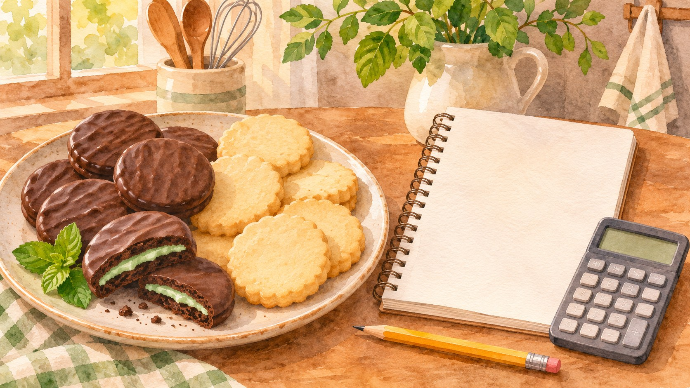
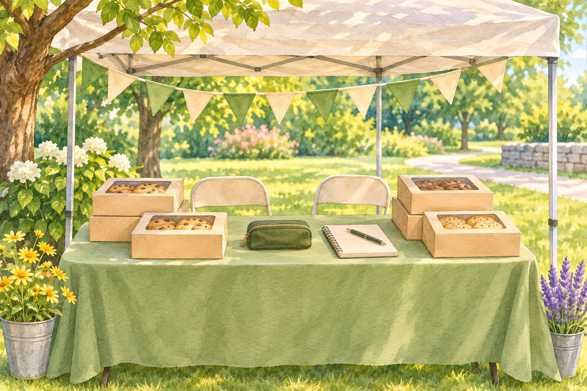

# Corona Cookie Season Heads-Up: Training November 24, Booths February 5

*AI-generated illustration; generic cookies, not a representation of the official 2027 product lineup.*

<!-- ARTICLE_BODY_START -->
Corona Girl Scout families can begin planning for the 2027 Cookie Program: Girl Scouts of San Gorgonio Council lists online coordinator training opening November 24, 2026, and cookie booths beginning February 5, 2027. This is an early planning reminder for volunteers and families, with neighborhood booth locations still to be confirmed.

There is plenty of time before a booth becomes part of the weekend shopping trip. For the adults helping a troop prepare, however, several important dates arrive before the holidays. Saving them now can make the season easier and leave more room for the young entrepreneurs at its heart.

## The council calendar is now available

The council's [2027 Cookie Program page](https://www.gssgc.org/en/cookies/resources-for-entrepreneurs/cookie-program.html) lists these milestones: online coordinator training opens November 24; troop initial orders are due December 13; marketing begins January 10; the Colorful Dash and Cookie Rally is January 16; Mega Drop is January 23; walkabouts begin January 24; booths begin February 5; and the program ends March 14.

The November and December dates fall in 2026; the January through March dates fall in 2027. Put the year beside each entry if you are forwarding the calendar to another caregiver. A training opening, a marketing start, a cookie pickup, and a booth opening each serve a different purpose.

Our earlier [Girl Scouts in Corona joining guide](https://coronashoutouts.com/a/girl-scouts-corona-join-troop-cookie-season) introduced local families to the program before these dates were confirmed in our coverage. This update supplies the published timeline. For the current calendar and any later changes, use the council's official program page.

## Coordinators have December deadlines, too

The council says coordinator registration is required to receive training through GS Learn. To receive cookies at Mega Drop on schedule, coordinators must register by December 7 and complete training by December 9, ahead of the December 13 initial-order deadline. Later completion moves ordering to a planned cupboard order available for pickup beginning January 25.

If you are coordinating for the first time, read those instructions before choosing when to complete training. Set aside time to ask questions afterward rather than aiming for the final evening. For troop-specific responsibilities, your troop leadership and council contacts are the right people to consult.

Parents can help by finding out who is coordinating and which communication channel the troop will use. Keep official instructions together, especially when several caregivers share transportation or scheduling. A single current message is easier to follow than a collection of screenshots from different seasons.

## Give girls room to practice their skills

Girl Scouts of the USA identifies five core skills in the cookie program: goal setting, decision making, money management, people skills, and business ethics. Its [financial empowerment resource](https://www.girlscouts.org/content/dam/gsusa/forms-and-documents/cookies/resources/Girl-Scouts-Financial-Empowerment-and-Entrepreneurship-Program.pdf) explains how planning, budgeting, customer conversations, and responsible choices connect to broader leadership learning.

Families can turn those ideas into low-pressure preparation at home. Invite your Girl Scout to describe something she wants to learn this season, then ask what practice would help. Perhaps she wants to speak more clearly, organize information, or feel comfortable answering a question. Let her choose a manageable starting point.

Try a pretend customer conversation at the kitchen table. One person asks about the troop's goal, and the other practices explaining it in her own words. Switch roles and listen together for what was clear. This is a practice suggestion, not an official council requirement, and it need not become a polished speech.

## Make a family plan that fits

Before committing to participation times, compare the troop's plans with school, work, and other activities. Ask about adult responsibilities, transportation, and the procedures that apply to sales opportunities. Clear expectations early are a kindness to the volunteers coordinating many families at once.

The [national cookie FAQ](https://www.girlscouts.org/en/cookies/how-to-buy-cookies/cookies-frequently-asked-questions.html) says participation is voluntary and requires written parent or caregiver permission. Adults may help, while Girl Scouts take the entrepreneurial role. Families should discuss a comfortable level of involvement with their troop rather than assuming everyone must participate in the same way.

Keep preparation focused on learning as well as logistics. Ask what felt easier after practice and what still needs explanation. A child who asks a thoughtful question or carefully checks information has done something worth recognizing. There is room to appreciate those efforts throughout the season.

*AI-generated illustration; not an approved booth location, product package, or sales setup.*

## What cookie fans can do right now

For neighbors eager to support a local Girl Scout, the useful action today is to save the dates and wait for verified ordering and booth information. February 5 is the council's booth start date; it does not confirm that any particular Corona storefront will host a troop that day.

When the season arrives, follow the [official cookie buying guidance](https://www.girlscouts.org/en/cookies/how-to-buy-cookies.html) or a verified sales link shared by a Girl Scout you know. Check the offered pickup or delivery arrangements before ordering. For ingredients and dietary questions, consult current product information and packaging rather than relying on a remembered variety name.

If you run a local business and would like to learn about supporting a booth, ask the council or troop leadership about the approved process. There are no confirmed Corona booth assignments in this reminder. Coordinated arrangements help families, volunteers, and hosts work from the same plan.

A simple planning page can help your household: write down the troop contact, the dates relevant to your role, and the questions still waiting for answers. Keep your own notes separate from official instructions so another caregiver can tell which details are confirmed. Review the page together when your troop sends an update, and replace outdated information instead of adding another conflicting reminder.

## New families are welcome to explore

Cookie season may be what first catches a family's attention, but our joining guide can help you begin a broader conversation about Girl Scouts. Visit [San Gorgonio Council](https://www.gssgc.org/) to ask about current membership options and troop availability for your child's grade and location.

Thank you to the volunteers preparing well before the first booth day, and to the families making space for children to learn. Save November 24 for the training opening and February 5 for the start of booths. For more friendly local reminders, [subscribe to Corona Shoutouts](https://coronashoutouts.com/s/6ab1ad770d309008f98923db) and share this update with a troop family who could use it.
<!-- ARTICLE_BODY_END -->

## Sources and editor notes

- [Girl Scouts of San Gorgonio Council 2027 Cookie Program](https://www.gssgc.org/en/cookies/resources-for-entrepreneurs/cookie-program.html), calendar and coordinator requirements, checked November 5, 2026.
- [GSUSA Five Skills resource](https://www.girlscouts.org/content/dam/gsusa/forms-and-documents/cookies/resources/Girl-Scouts-Financial-Empowerment-and-Entrepreneurship-Program.pdf).
- [National cookie FAQ](https://www.girlscouts.org/en/cookies/how-to-buy-cookies/cookies-frequently-asked-questions.html).
- [Official buying guidance](https://www.girlscouts.org/en/cookies/how-to-buy-cookies.html).
- No prices, local booth assignments, current product lineup, troop sales goals, or specific proceeds allocation asserted.
- Earlier live joining guide contains an outdated statement about dates not yet being available; this draft clearly supplies the update without modifying that live article.
- Two original AI-generated illustrations; generic products and booth. Draft only.
