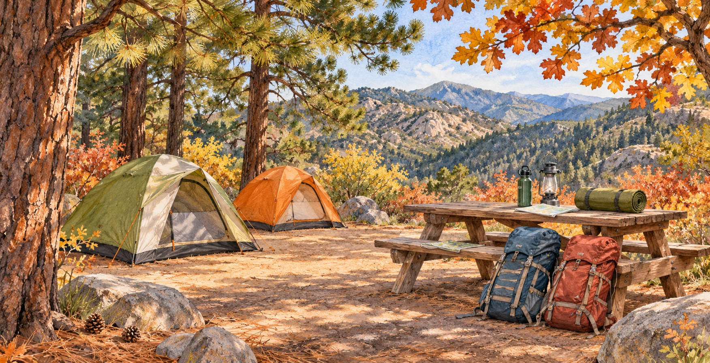
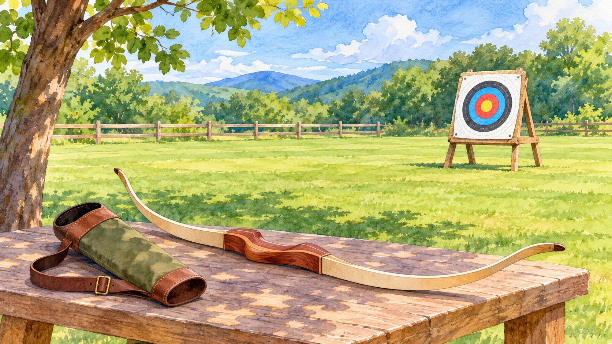

# Corona Scout Families: Webelos Woods This Weekend, Archery November 14

*AI-generated illustration for Corona Shoutouts; not a photograph of the event or its campsite.*

<!-- ARTICLE_BODY_START -->
Corona Scout families have two November dates to keep handy: Webelos Woods runs November 6–8, and Cub Scout Archery Day is listed for November 14. Webelos Woods registration closed November 4, so this weekend's reminder is especially useful for families already signed up. New to Scouting? Our local joining guides can help you get started.

With backpacks, school projects, and weekend plans competing for attention, a little preparation now can make the next adventure easier. Here is what the official California Inland Empire Council information confirms, what families should check with their leaders, and how neighbors can find a pack or troop close to home.

## Webelos Woods: a reminder for registered families

The council's [Webelos Woods registration page](https://ciecbsa.doubleknot.com/event/webelos-woods-2026/3162873) lists the event from Friday, November 6, at 5 p.m. through Sunday, November 8, at 10 a.m. The address is 53155 Idyllbrook Drive, Idyllwild, CA 92549. Listed fees are $45 per Webelos or Arrow of Light Scout and $25 per adult or leader.

The page now says the registration deadline has passed. If you missed it, contact your unit leader or the organizer before making plans; this reminder does not mean that late registration or walk-in attendance is available. The listed event contact is Kristina Milam at kristina.milam@scouting.org.

Already registered? Reopen the event page and follow its Event Guide link, then compare those instructions with the information your pack sent home. Confirm your arrival plan, required paperwork, and who will serve as your family's contact during the weekend. Keep the destination address somewhere you can reach without searching a long message thread.

For families driving from Corona, build the trip around the organizer's check-in instructions. Ask your leader about transportation arrangements and leave room for the ordinary stops that come with traveling with children. The published start time is a scheduling reference; your group's meeting time may be different.

If you are sharing this reminder with grandparents or another caregiver, include your unit contact and the confirmed itinerary. That keeps the practical details with the people helping your Scout get ready.

## Make the preparation part of the adventure

Before packing, let your Scout help review the official equipment list. Give them a few manageable jobs, such as checking a flashlight, locating their water bottle, or putting their clothing together. That makes preparation a shared activity and gives adults a chance to discover anything missing while there is still time to ask for help.

Use the event guide for specific equipment requirements and consult current forecasts for the destination. A comfortable afternoon in Corona does not tell you what a mountain evening will feel like. Ask your leader about sleeping arrangements, meals, personal items, and any supplies the unit provides before buying extra gear.

If this is a child's first overnight experience, invite questions in advance. Who will be nearby? Where will belongings go? What happens if something feels unfamiliar? Your leader can explain the actual plan, and a short conversation at home can help your child arrive knowing which adult to approach.

## Cub Scout Archery Day is on November 14

The council's [November events calendar](https://iescouts.org/events/) lists Cub Scout Archery Day for Saturday, November 14. The linked registration page returned a session error during our check, so we could not independently confirm its time, venue, fee, available spaces, or registration deadline. Please verify those details directly before registering or traveling.

Ask your pack leader whether the event fits your child's current program level and how your pack plans to participate. Also ask about adult attendance, equipment, check-in, and any instructions families should review beforehand. A calendar listing is a useful reminder, but the organizer's current event instructions should guide your plans.

Families can keep the conversation encouraging: listening carefully, waiting patiently, and following the range staff's directions are good things to discuss before arrival. Let the instructors handle the technical guidance. There is no need to purchase archery equipment for an event unless the organizer specifically tells you to bring it.

*AI-generated illustration; not the November 14 venue or its equipment.*

## New to Scouting? Start with our Corona guides

Our [Cub Scouts joining guide](https://coronashoutouts.com/a/cub-scouts-corona-joining-guide) introduces the pack program for younger children, while our [Scouts BSA troop guide](https://coronashoutouts.com/a/scouts-bsa-corona-how-to-join-a-troop) helps families exploring the next stage. Use them to prepare questions, then confirm current membership details with the council or the unit you hope to visit.

You can also use the council's [Join Scouting page](https://iescouts.org/join-scouting/) to request help. Its form asks for your city, your child's grade and school, and a way to contact you. That gives the council a practical starting point for connecting your family with a suitable local program.

When speaking with a pack or troop, explain your family's real schedule. Ask when meetings happen, how often outings are offered, what participation costs, and whether you can visit before deciding. If your child has accessibility needs or needs extra time to feel comfortable, ask how the unit can support a visit.

## A few questions to settle before the weekend

For registered Webelos Woods families, the most useful check tonight is a brief one: confirm that your registration is complete, your leader has the information requested, your transportation is arranged, and your Scout knows where the group will meet. Ask unresolved questions before departure rather than relying on another family's assumptions.

For the November 14 archery day, your next step is different: obtain the working registration information from the council or your pack. Save the confirmed details together so every caregiver involved has the same instructions. If a date does not work for your family, ask about future opportunities instead of squeezing an unfamiliar outing into an already crowded weekend.

And if your household is simply curious, sharing a joining guide with another parent is a friendly place to begin. You do not have to make a commitment today to learn what is available. Sometimes the most helpful first step is finding someone who can answer your child's questions.

Wishing our registered families a well-prepared, happy weekend, and our newest neighbors a warm welcome to exploring Scouting. Have a pack, troop, or volunteer story worth celebrating? [Send Corona Shoutouts a note](https://coronashoutouts.com/a/corona-contact), and [subscribe](https://coronashoutouts.com/s/6ab1ad770d309008f98923db) for more positive community reminders.
<!-- ARTICLE_BODY_END -->

## Sources and editor notes

- [California Inland Empire Council events](https://iescouts.org/events/), checked November 5, 2026.
- [Webelos Woods 2026 registration](https://ciecbsa.doubleknot.com/event/webelos-woods-2026/3162873), including closed registration status.
- [Cub Scout Archery Day registration link](https://ciecbsa.doubleknot.com/event/cub-scout-archery-day-2026/3155845) returned a session error. Date confirmed on council calendar; other logistics remain unverified.
- [Council joining page](https://iescouts.org/join-scouting/).
- Recheck time-sensitive details before publication. Do not present either event as open drop-in recreation.
- Two original AI-generated illustrations; no actual Scouts, event photography, or official endorsement depicted.
