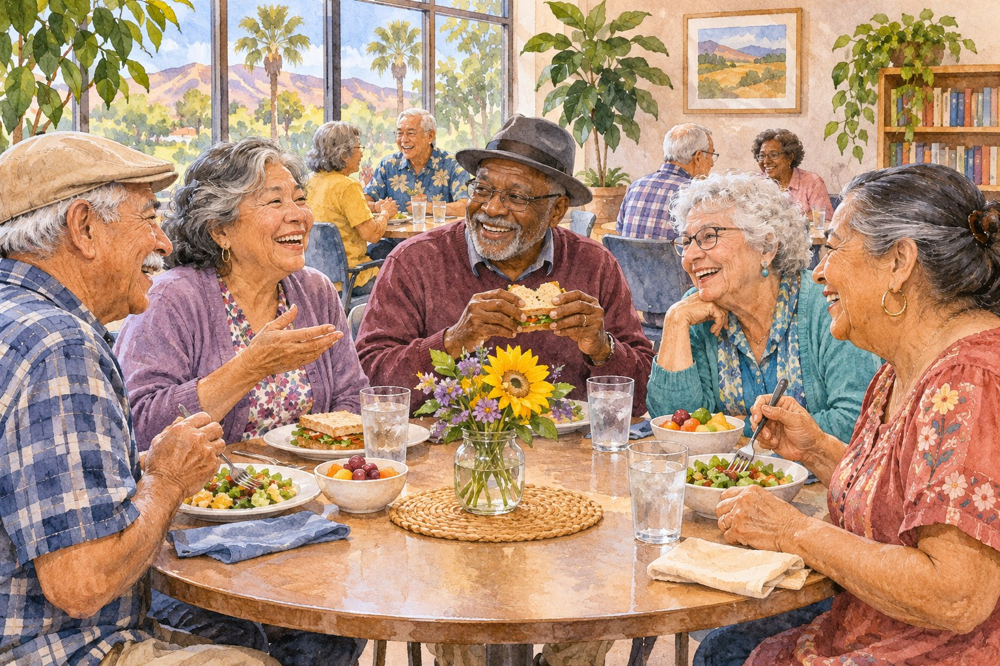

# A Place to Begin: Lunch, Learning, and Friendship at Corona Senior Center

*AI-generated illustration; not actual Corona Senior Center participants or facilities.*

<!-- ARTICLE_BODY_START -->
Corona Senior Center offers a local starting point for adults looking for activities, learning, and time with neighbors. General membership begins at age 50, while the weekday nutrition program serves adults 60 and older. Lunch is listed for noon, Monday through Friday, with a $3 suggested donation and a yearly reassessment form.

If you have wondered about going but have not made a first visit, you can begin with a phone call. Ask about one activity that interests you or explain that you would like to learn how the center works. You do not need an established group of friends or a full schedule to start exploring.

## Use the center's facility address

The [City of Corona's facility directory](https://www.coronaca.gov/parks-facilities-directory/corona-senior-center) lists Corona Senior Center at 921 South Belle Avenue, Corona, CA 92882. Its front-desk number is 951-736-2363. The directory lists accessible facilities, restrooms, a meeting room, a drinking fountain, and a fitness room among the amenities.

The broader [senior-program page](https://www.coronaca.gov/departments/community-services/senior-center) also displays a department contact address on Vicentia Avenue. For a visit to the center, use the Belle Avenue facility listing and confirm your particular activity's location when calling. That small distinction can save an unnecessary trip to the wrong building.

Write the address and phone number on paper if that is easier than finding them on a phone. If a friend or family member is driving, share the confirmed location and the time you expect to finish. Making the arrival simple leaves more attention for enjoying the visit.

## Lunch: understand the age rule and donation

The city's nutrition information describes noon weekday meals for adults 60 and older, served on a first-come, first-served basis. It calls $3 a suggested donation, rather than listing it as a required meal ticket. A yearly reassessment form is required. Ask the front desk how to complete it and how meal service is operating on your intended day.

If cost is a concern, ask staff to explain the donation policy directly. If you have dietary questions, ask what the program can accommodate before relying on the meal. This guide does not promise a particular menu, a reserved place, or a special meal arrangement.

Consider whether you would enjoy staying for conversation or whether a short visit feels right for the first day. Either approach can be a comfortable introduction. If you invite someone along, make sure they check their own meal eligibility and paperwork instead of assuming the same arrangements apply to every guest.

## Membership and choosing an activity

The center's FAQ says membership is for adults 50 and older, with no membership fee. Joining requires a completed registration form and valid identification presented to staff. Some activities and events have small fees. Ask for the current schedule and the specific cost, registration process, and availability for anything you want to try.

The city's [Fall 2026 Corona Connection](https://fliphtml5.com/vxgcb/FA26-Corona-Connection/) explains that senior drop-in classes use front-desk sign-in and a wristband, with space available first come, first served. Confirm whether that process applies to your chosen class and how early staff recommend arriving.

Start with your interests rather than what someone else thinks you should enjoy. Perhaps you want a creative project, a game, or a chance to learn something new. Ask whether an activity is suitable for beginners and whether supplies are provided. You can gather information without committing to a whole season.

## Free talks and a Thanksgiving question

The center describes free educational lectures, generally on Wednesdays at 12:15 p.m., with dates and times subject to variation. Request the current topic list and confirm the date you have in mind. A general weekly schedule does not establish that a presentation will happen during a holiday week.

The city also names an annual Thanksgiving luncheon among its special events. A confirmed 2026 date was not found in the materials reviewed for this article. Ask staff when the details will be available and whether reservations or payment will be needed. Do not rely on an older flyer or last year's date.

When details are confirmed, put them somewhere you use every day: a paper calendar, a note beside the phone, or your usual digital reminder. Include the registration deadline separately if there is one. Being interested in an event and having a confirmed reservation are two different steps.

*AI-generated illustration; not a photograph of a scheduled center class.*

## Make a first visit comfortable

Before leaving home, ask where newcomers check in and what the activity involves. Mention access or seating questions that matter to you. If you plan to bring a support person, ask how they should register or participate. Clear arrangements help both you and the staff preparing to welcome visitors.

If transportation is the missing piece, review [Corona Dial-A-Ride](https://www.coronaca.gov/departments/public-works/public-transit/dial-a-ride) and contact dispatch at 951-734-7220 about eligibility and the particular trip. Confirm the fare directly because the city's published fare details conflict. Build the return journey into your planning as well.

On arrival, let the front desk know this is your first visit. Ask a question whenever an instruction is unclear. You can also tell staff if you would prefer a quieter introduction before joining a larger activity. Being new is a normal part of becoming familiar with a place.

## A kind invitation for friends and families

If someone you care about might enjoy the center, offer a specific, low-pressure kind of help: finding the phone number, sharing a calendar, or going along for an introductory visit. Let them decide what appeals to them and how much assistance they want. Their preferences should guide the plan.

Afterward, ask yourself what worked well and what you would change next time. You may prefer a different activity, a shorter stay, or more information before returning. Those preferences are useful when planning another visit.

A first visit does not have to become a weekly commitment. It can simply answer a question, introduce a friendly face, or help someone discover an activity worth returning for. We hope every Corona neighbor exploring the center finds useful information and a welcome that respects their independence. Share this guide with someone who may appreciate it, and [send Corona Shoutouts](https://coronashoutouts.com/a/corona-contact) your positive community story.
<!-- ARTICLE_BODY_END -->

## Sources and editor notes

- City senior-program page, facility directory, and Fall 2026 Corona Connection linked in the body; checked November 5, 2026.
- Current facility address is 921 S. Belle Avenue; department contact address differs.
- $3 is a suggested meal donation. General membership age 50 differs from lunch age 60.
- Thanksgiving luncheon date unconfirmed. Linked monthly PDFs were October materials; no November talk date invented.
- No ride fare, guaranteed meal seat, medical benefit, or individual accommodation promised.
- Two original AI-generated illustrations. Draft only.
