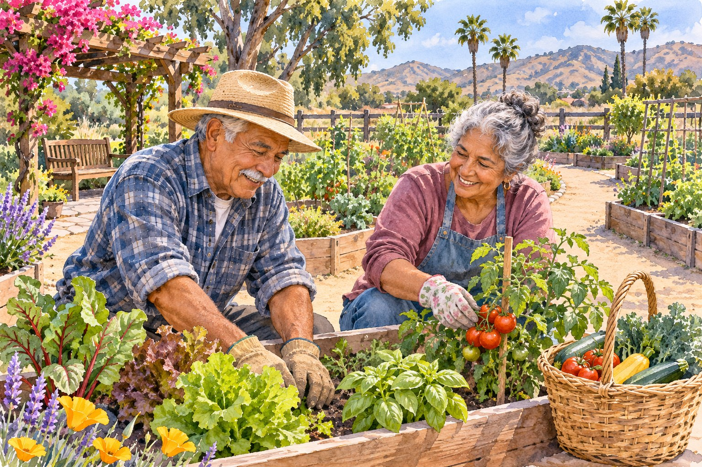
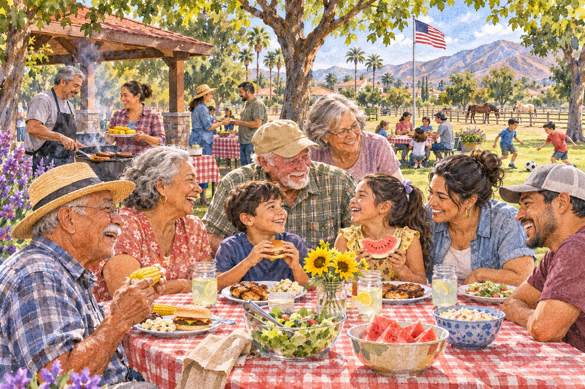

# Norco With Care: Senior Center Connections and a Veterans Day Invitation

*AI-generated illustration; not Norco's actual senior garden or its participants.*

<!-- ARTICLE_BODY_START -->
Norco's Rose M. Eldridge Senior Center offers adults 50 and older a place to explore activities, classes, and community resources. This November also brings a free Veterans Day ceremony on November 11 at 10 a.m., followed by a Lions Club barbecue picnic. Both are opportunities to connect, with different locations and participation details to check.

For someone considering a first senior-center visit or an invitation to a veteran in the family, a little clear information can help. Here are the practical starting points, along with ways to make an outing comfortable and respectful of each person's interests and choices.

## Start with an activity that appeals to you

The [Rose M. Eldridge Senior Center](https://www.norco.ca.us/departments/community-services/senior-programs-resources) is at 2690 Clark Avenue, Norco. Its general program serves adults 50 and older, but individual resources may have different eligibility rules. Contact the center at 951-270-5647 or seniorcenter@ci.norco.ca.us for the current schedule and help finding a suitable starting point.

The city's [activities page](https://www.norco.ca.us/departments/community-services/senior-programs-resources/activities-classes) says classes are free and led by volunteer instructors. Participants must complete a registration packet before joining classes and activities. Ask staff for the current packet and whether your chosen activity needs advance registration, supplies, or an additional arrangement.

Its listed options include crafts, ceramics, quilting, yoga, exercise, games, and karaoke. Some online time entries contain obvious formatting problems, so use the schedule as a starting point and confirm the particular session. Choose something that interests you; you do not need to arrive with a long-term plan.

## Games, a weekday meal, and familiar faces

The [meetings and clubs page](https://www.norco.ca.us/departments/community-services/senior-programs-resources/meetings-clubs) lists Tuesday Bingo from 1 to 4 p.m., with limited space on a first-come basis. Ask about the current session and any playing costs. Free classes do not establish that every game, special event, or separate fundraiser is free.

Norco's [meal information](https://www.norco.ca.us/departments/community-services/senior-programs-resources/assistance-resources) describes weekday lunch from 11:30 a.m. to 12:30 p.m. for adults 60 and older. Meals are listed as free with a $3 suggested donation. Enrollment begins with an application from the front desk; ask about availability, menus, and holiday changes.

For a first visit, you might simply ask how lunch check-in works or whether there is a beginner-friendly game session. If you would like to bring someone, confirm their participation arrangements separately. A companion can make an introduction easier, but going on your own is a perfectly reasonable way to begin.

## A garden with its own joining process

The city's senior-center page describes a 1.4-acre garden with a community orchard and 22 garden tracts available to Norco residents. It directs interested residents to the welcome desk to join a waitlist. Open garden hours do not mean that an unassigned plot is available for immediate use.

If gardening appeals to you, ask about current availability, eligibility, responsibilities, and any costs before planning a project. You can also ask what access and working arrangements the garden provides. A program description cannot tell you whether its particular layout will suit your needs.

The city's assistance page also describes Bouquets of Kindness, a program connecting garden produce when available, flowers, cards, and volunteers with seniors who could use encouragement. Contact staff to ask about current participation or volunteer needs. No produce quantity, delivery date, or open role is promised in this guide.

## Veterans Day: arrive for the November 11 ceremony

The [official Veterans Day page](https://www.norco.ca.us/events-attractions/community-events/veterans-day) lists Wednesday, November 11, 2026, at 10 a.m. at George A. Ingalls Veterans Memorial Plaza, 3737 Crestview Drive. Seating is limited, and attendees are asked to arrive by 9:45 a.m. Admission and parking are free; enter through Gate A and follow directional signs.

The ceremony is followed by a free picnic with barbecue provided by the Norco Lions Club. On the freshly retrieved city page, the picnic location is the Ingalls Event Center arena level. Earlier indexed information named Pikes Peak Park. Use the latest official instructions and follow event staff's directions rather than relying on an old location reference.

The city asks people needing modifications or accommodations to contact it at least 48 hours before the event. Plan ahead for those questions, and check the event's current rules before bringing items. The official page prohibits alcohol and personal barbecues, requires leashed pets, and notes that ice chests may be searched.

*AI-generated illustration; not the actual Veterans Day picnic, location, or attendees.*

## Extend an invitation with room for a choice

If you know a veteran who might enjoy attending, offer the verified details and ask whether they would like company. They may prefer the ceremony, the meal afterward, or another way of spending the day. Let the invitation be welcoming without making attendance feel like an obligation.

Ask before taking or sharing someone's photograph, and let them decide whether to talk about their service. A simple thank-you can be meaningful without asking for personal memories. If family members are gathering, agree on where to meet and how everyone will get between the ceremony and picnic areas.

For older attendees, check walking distances, seating arrangements, and transportation before committing to the outing. Ask the organizer what is available rather than promising assistance on its behalf. Clear plans help friends and family spend the day together with fewer practical questions left unanswered.

## Ask about transportation and take one next step

Norco's [Seniors on the Move transportation program](https://www.norco.ca.us/departments/community-services/senior-programs-resources/transportation-program) serves eligible Norco residents and has its own rules, reservation process, and trip purposes. Contact the center about a specific journey. Do not assume a general service description guarantees transport to a class or the Veterans Day event.

Keep the center address and event address on separate notes if you are planning both outings. They are different destinations, and a familiar program name can be easy to confuse with a ceremony location when arranging a ride.

Perhaps your next step is a call about a garden waitlist, a weekday meal, or a first class. Perhaps it is inviting someone to the November 11 ceremony and listening to what they would enjoy. We hope these resources help Norco neighbors find useful support and good company. [Share a positive local story with Corona Shoutouts](https://coronashoutouts.com/a/corona-contact) so we can keep celebrating the people who care for this community.
<!-- ARTICLE_BODY_END -->

## Sources and editor notes

- Norco senior-program, activities, assistance, meetings, and transportation pages linked beside the relevant details; checked November 5, 2026.
- Veterans Day page freshly retrieved: picnic at Ingalls Event Center arena level, differing from older search text naming Pikes Peak Park. Recheck before publication.
- General center age 50 differs from lunch age 60. Garden plots restricted to Norco residents, with waitlist. No free Bingo claim.
- No specific class session, transport to the ceremony, garden opening, or volunteer vacancy guaranteed.
- Two original AI-generated illustrations. No actual garden participants or ceremony depicted. Draft only.
