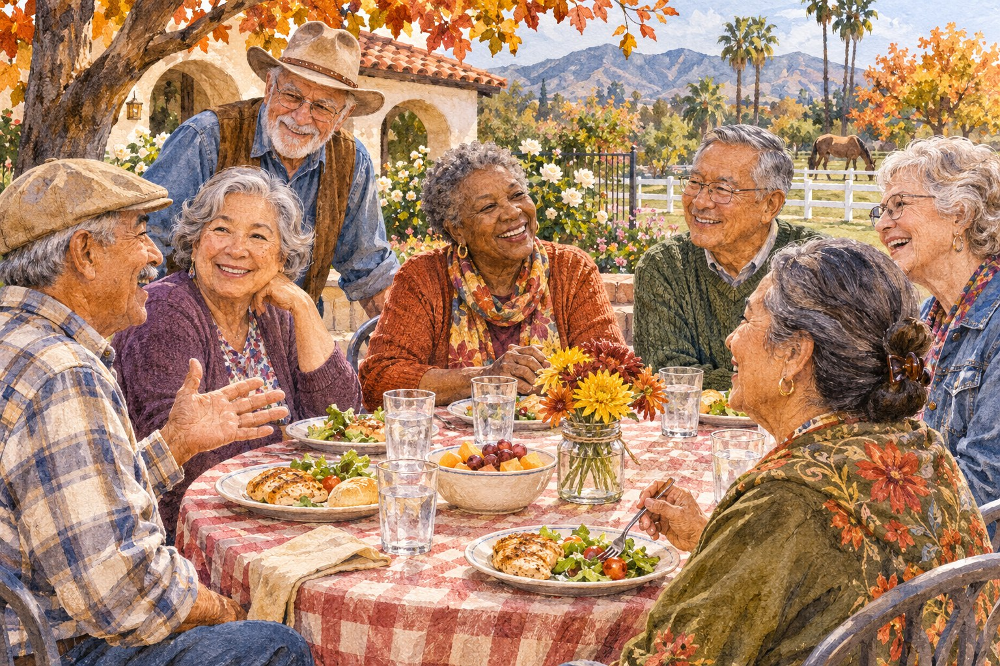

# November for Corona and Norco Older Adults: Meals, Learning, Rides, and Community

*AI-generated illustration; fictional neighbors and setting, not an actual program photograph.*

<!-- ARTICLE_BODY_START -->
Older adults in Corona and Norco have several welcoming options this November: weekday meals, library technology learning, senior-center activities, transportation assistance, and Norco's November 11 Veterans Day gathering. This guide brings the practical starting points together so you can choose what suits you, check arrangements, and enjoy time in your community.

You might be looking for one class, a place to share lunch, or a way to get somewhere without driving. There is no need to fill your calendar. Start with something useful or enjoyable, and let the staff running that program help you understand the next step.

## A weekday lunch and a welcoming starting point

The [Corona Senior Center](https://www.coronaca.gov/departments/community-services/senior-center) lists lunch Monday through Friday at noon for adults 60 and older, on a first-come basis. The city describes $3 as a suggested donation and requires a yearly reassessment form. Ask the front desk about enrollment, current meal availability, and holiday changes before your first visit.

The [city's facility directory](https://www.coronaca.gov/parks-facilities-directory/corona-senior-center) places the center at 921 South Belle Avenue, Corona, with a front-desk number of 951-736-2363. Use that facility address when planning a visit; the broader department page also displays an administrative address on Vicentia Avenue.

If you would enjoy company, invite a friend to ask about the program with you. If you prefer to begin alone, that is fine too. Calling ahead gives you a chance to ask where to check in and what to bring, so the first visit feels a little more familiar.

## Wednesday talks and Thanksgiving plans

Corona's center says educational lectures are free and generally held Wednesdays at 12:15 p.m., although dates and times vary. Check the current topic and schedule with staff. A recurring Wednesday description is not confirmation that a talk will happen on Veterans Day or another holiday.

The city also describes an annual Thanksgiving luncheon, but a confirmed 2026 date was not found in the materials checked for this guide. Please contact the center about the date, reservations, and any cost before making arrangements. There is no luncheon date to put on this calendar yet.

When asking about an event, mention anything that would help you take part comfortably, such as seating or access questions. You do not need a lengthy explanation to request practical information. A clear question gives the organizer a better chance to point you toward the right arrangements.

## Library learning for everyday technology

Corona Public Library lists [Phone Security & Privacy](https://coronacalibrary.libcal.com/event/17737068) for Saturday, November 14, from 10 a.m. to noon. Registration is required. The page showed 10 seats available when checked November 5, a number that can change. For registration and format confirmation, call 951-279-3746 or email Literacy.Corona@CoronaCA.gov.

The listing labels the workshop in person in the Computer Learning Center but also contains conflicting online-event wording. Confirm attendance instructions with staff. Learning materials and supplies are listed as free. This is a practical opportunity to ask about phones, account protection, permissions, and privacy without assuming you should already know the terminology.

The [Basic Computer Skills & Keyboarding course](https://coronacalibrary.libcal.com/event/17083988) meets on listed Thursdays from 10 a.m. to 1 p.m., with dates extending through December 17. November 26 is absent from its date list. Begin with the linked interest form and ask CNUSD Adult Education at 951-736-3325 about joining the course and its current arrangements.

## Norco honors veterans on November 11

Norco's [official Veterans Day page](https://www.norco.ca.us/events-attractions/community-events/veterans-day) lists a free ceremony Wednesday, November 11, at 10 a.m. at George A. Ingalls Veterans Memorial Plaza, 3737 Crestview Drive. Seating is limited; the city asks attendees to arrive by 9:45 a.m. Parking is free, with directions through Gate A.

A free picnic with barbecue provided by the Norco Lions Club follows the ceremony. The freshly retrieved city page lists the picnic at the Ingalls Event Center arena level. Earlier indexed information named a different park, so check the current page and follow event staff's directions before heading to the meal.

If you are inviting a veteran, ask what kind of day they would enjoy. They may welcome the ceremony, prefer the picnic, or choose a quiet visit with family. A thoughtful invitation leaves room for their preference and does not require anyone to share personal service experiences.

*AI-generated illustration; decorative planner, not an official schedule.*

## Make transportation part of the plan

[Corona Dial-A-Ride](https://www.coronaca.gov/departments/public-works/public-transit/dial-a-ride) provides shared curb-to-curb transportation for eligible riders, including adults 60 and older. Senior eligibility requires an application and a Dial-A-Ride ID. Reservations are taken at 951-734-7220, generally one to 14 days ahead. Ask about your exact journey and return trip.

The city's fare information contains conflicting dates and descriptions, so this guide does not print a senior fare. Confirm the current amount and payment arrangements with dispatch. Also explain any mobility-device or assistance needs when booking; a general service description cannot establish what is available for your particular trip.

Norco's [Seniors on the Move](https://www.norco.ca.us/departments/community-services/senior-programs-resources/transportation-program) is a separate program with Norco residency rules. Ask its senior center at 951-270-5647 about eligibility, destinations, and availability. Being eligible for one city's transportation service does not automatically qualify someone for the other's.

## Explore Norco's center at your own pace

The [Rose M. Eldridge Senior Center](https://www.norco.ca.us/departments/community-services/senior-programs-resources) serves adults 50 and older at 2690 Clark Avenue, Norco. Its offerings include classes, games, meal resources, and a senior garden. Some services have different age or residency requirements, so ask about the particular activity that interests you.

If you are helping another person use this guide, ask which opportunity interests them before arranging anything. Offer to read the details aloud, print a page, or sit together during a call if requested. Keep their decisions with them. A helpful plan should reflect the person attending, including the time, company, and level of assistance they would prefer.

Choose one first step: call about lunch, request a class schedule, ask about a ride, or register for a workshop. Share this guide with a friend or caregiver if it would help them plan alongside you. We hope November brings useful answers, welcoming conversations, and time doing something you enjoy. [Corona Shoutouts](https://coronashoutouts.com/) is glad to help neighbors find their way to those opportunities.
<!-- ARTICLE_BODY_END -->

## Sources and editor notes

- Linked official municipal and library pages checked November 5, 2026. Exact event and resource links appear beside relevant details.
- Corona lunch is a suggested donation, not a compulsory $3 ticket. Thanksgiving luncheon date remains unconfirmed.
- Workshop seats changed from the user's earlier count of 14 to 10 when checked. Verify availability and conflicting online/in-person text before attending.
- Latest live Norco Veterans Day page places picnic at Ingalls Event Center arena level; cached search text names Pikes Peak Park. Use live instructions and recheck.
- No Dial-A-Ride fare printed or phone call claimed. No registrations or bookings made.
- Two original AI-generated illustrations, with alt text. Draft only.
