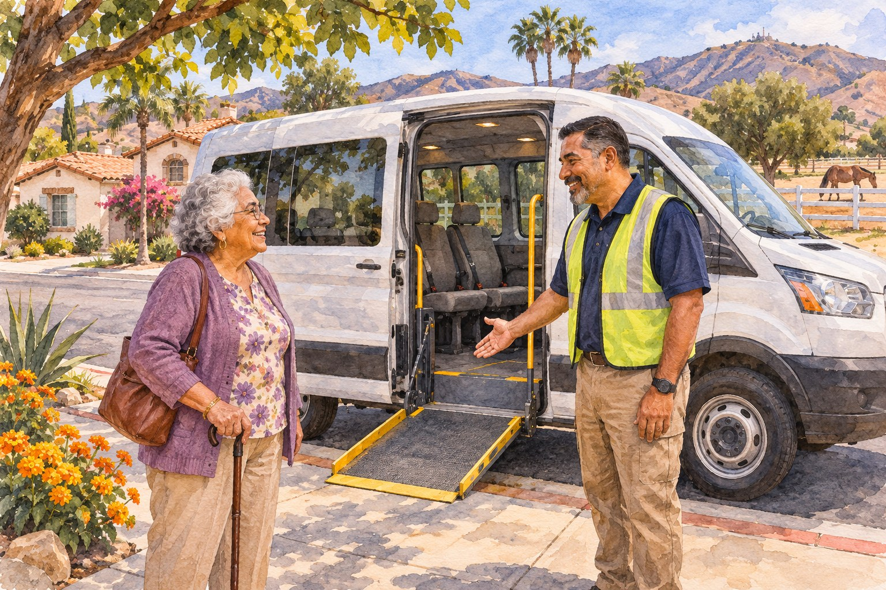

# Getting There With Confidence: Senior Rides in Corona and Norco

*AI-generated illustration; not an actual vehicle, driver, passenger, or stop for either service.*

<!-- ARTICLE_BODY_START -->
Corona and Norco offer different transportation programs that may help eligible older adults reach appointments, shopping, and other everyday destinations. Corona Dial-A-Ride includes a senior category for adults 60 and older. Norco's Seniors on the Move serves eligible Norco residents, including seniors 50 and older. Contact each service about your specific trip before relying on it.

Having another way to get somewhere can make a community activity or ordinary errand easier to consider. The useful first step is understanding the service, its eligibility process, and how reservations work. This guide helps you prepare that conversation while keeping your choices and needs at the center.

## Corona Dial-A-Ride: begin with eligibility

The [City of Corona describes Dial-A-Ride](https://www.coronaca.gov/departments/public-works/public-transit/dial-a-ride) as shared curb-to-curb transportation for eligible riders, including adults 60 and older, people with disabilities, and ADA-certified passengers. Applying under the senior or disabled category requires an eligibility application and a Dial-A-Ride ID; the city separately explains arrangements for people with a valid ADA ID.

Application questions can go to 951-736-2266 or CoronaTransit@CoronaCA.gov. Reservations use a different number: 951-734-7220, with trips generally requested one to 14 days ahead. Ask whether your eligibility is established before treating a reservation request as ready to proceed.

The city's current online fare information includes conflicting dates and descriptions, so we are leaving a senior fare out of this article. Ask dispatch what you would pay now, whether a subsidy applies to your category, and how payment works. We have not called to resolve that discrepancy or verified a fare by phone.

## Norco's separate program has residency rules

[Seniors on the Move](https://www.norco.ca.us/departments/community-services/senior-programs-resources/transportation-program) is Norco's door-to-door service. The city describes eligibility for Norco resident seniors 50 and older, able-bodied Norco resident military veterans 50 and older, and disabled Norco residents of any age. Ask the program which category and application requirements fit your situation.

Norco describes transportation as free, with service for necessary errands and appointments within a 30-mile radius outside its city limits. Examples include grocery shopping, medical visits, prescriptions, bills, postal services, and banking. The wording does not guarantee that every destination or purpose is approved; confirm your actual journey.

Reservations are first come, first served, and the city encourages requests at least a week ahead. Contact Rose M. Eldridge Senior Center at 951-270-5647 or seniorcenter@ci.norco.ca.us to confirm operating hours and availability. A radius shown on a website is not a substitute for an accepted reservation.

## Prepare the details before you call

Write down your pickup address, destination address, travel date, and the time you need to arrive. If the destination is a large building, identify the entrance you expect to use. A street address alone may leave an important question unanswered when a property has several entrances or pickup areas.

Describe the appointment's start time separately from the time you would like to be picked up. For a medical appointment, you may also need time for check-in. Let the reservation staff explain what pickup and arrival arrangements the service can offer instead of assuming the ride will operate like a private car.

Ask about the return trip during the same conversation. If you cannot predict when you will finish, explain that uncertainty and ask what procedure applies. Do not assume a driver will wait or that a phone call after the appointment will automatically produce an immediate ride home.

## Explain assistance needs in plain language

Curb-to-curb and door-to-door describe different service arrangements, and the terms do not answer every individual question. Tell the service if you use a wheelchair, walker, or another mobility device. Ask about boarding, the pickup location, and any assistance you need rather than waiting until the vehicle arrives.

If you travel with a personal care attendant, companion, or service animal, discuss the applicable policy when reserving. Ask whether that person must be included in the booking and whether any separate charge or eligibility rule applies. Do not infer those details from a general statement about senior transportation.

You can ask staff to repeat information, spell a street name, or explain an unfamiliar term. A useful reservation conversation ends with both sides understanding the plan. If someone helps make the call, remain part of the discussion as much as you wish and make sure the arrangement reflects your preferences.

*AI-generated illustration; fictional person, not a transportation booking in progress.*

## Keep one clear record of the trip

After the call, note the confirmed arrangements, any pickup window explained by staff, the return procedure, and the number to use if plans change. Record any fare or payment instructions you were given. If a detail remains undecided, mark it as a question rather than writing it as confirmed.

Share that note with a caregiver or companion if you want them involved. Keeping one current record can prevent confusion when several people are helping with the same outing. If an appointment changes, contact the service about updating or canceling the ride and follow its instructions.

Before travel day, make sure you can find the contact number without searching through messages. Check the destination's own hours as well, especially during November holidays. A transportation reservation and an open destination are separate things to confirm; one does not establish the other.

## Support that respects independence

If you are helping a parent, spouse, friend, or neighbor, begin by asking what would be helpful. They may want assistance finding the application, comparing options, or writing down instructions. They may prefer to make the call themselves once the correct number is available.

For a first outing, choose a plan with enough room for questions and avoid combining several unconfirmed stops. Once you understand the service, you can ask about more complicated journeys. The aim is a practical arrangement that works for the rider, with clear expectations for everyone involved.

Whether the next trip is for an appointment or something enjoyable, we hope this information makes the first call easier. Save Corona dispatch at 951-734-7220 and Norco's senior-center contact at 951-270-5647, then ask about the journey you actually need. Share this guide with someone who could use it, with the same care you would bring to helping a neighbor get home comfortably.
<!-- ARTICLE_BODY_END -->

## Sources and editor notes

- [Corona Dial-A-Ride](https://www.coronaca.gov/departments/public-works/public-transit/dial-a-ride) and [Corona public transit overview](https://www.coronaca.gov/departments/public-works/public-transit).
- [Norco transportation](https://www.norco.ca.us/departments/community-services/senior-programs-resources/transportation-program) and [assistance resources](https://www.norco.ca.us/departments/community-services/senior-programs-resources/assistance-resources).
- Checked November 5, 2026. No fare printed for Corona. No phone confirmation, bookings, applications, or guaranteed trip eligibility claimed.
- Norco's free service includes residency, purpose, radius, availability, and registration restrictions; it is not unrestricted transportation for all area residents.
- Two original AI-generated illustrations; no actual operator branding. Draft only.
