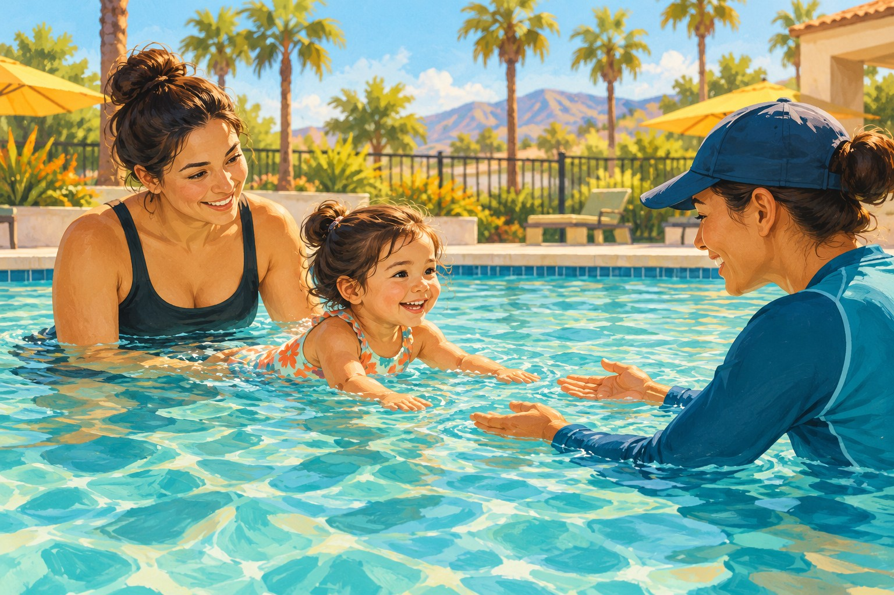
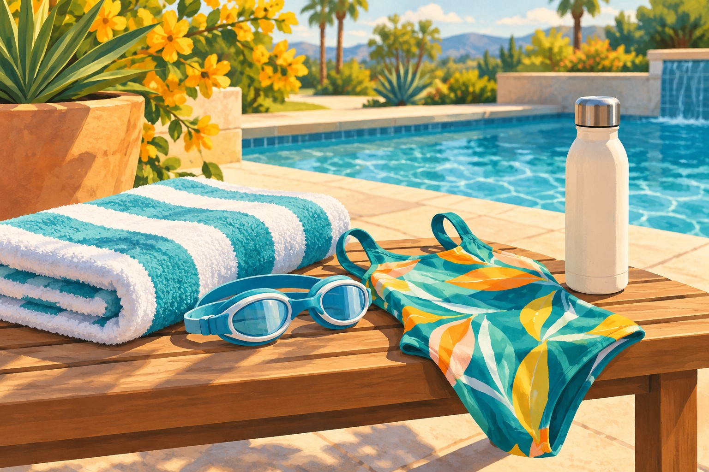

# Swim Lessons in Corona: Where Kids Learn to Swim (and Stay Safe)

*AI-generated editorial illustration; depicts a conceptual scene, not a specific local person, place or program.*

For Corona swim lessons, start with the Corona-Norco Family YMCA, the city’s aquatics partner. Its current lesson page lists Saturday classes at Corona High School and Eleanor Roosevelt High School in Eastvale, with options from parent-and-child learning through teen and adult instruction. Confirm placement and availability before registering.

Learning to swim is a family project that can begin with one manageable session. The goal is progress in the water, a clearer understanding of your child’s abilities, and safer habits around every pool they encounter—not simply finishing a class.

## Where Corona’s city-linked lessons happen

The [City of Corona aquatics page](https://www.coronaca.gov/departments/recreation-services/aquatics) directs families to the YMCA for year-round lessons and aquatics programming. That distinction helps when an online search produces an old summer flyer or a pool listing without a current class schedule.

The [YMCA’s current swim-lesson page](https://www.ymcacornor.org/swimming-lessons) identifies **Corona High School, 1150 W. Tenth Street**, and **Eleanor Roosevelt High School, 7447 Scholar Way, Eastvale**, as Saturday lesson locations. Eleanor Roosevelt is a nearby option, but it is in Eastvale rather than Corona.

The page lists a session running **October 31–November 21, 2026**, with registration beginning October 19, and a **December 5–19** session with registration beginning November 16. Those dates describe the posted schedule; they do not confirm a seat remains available in a particular class.

For lesson questions, the YMCA lists **951-284-4585** and **Swim@ymcacornor.org**. Ask which pool your class uses, where families should enter, and what happens if weather or a school activity affects a lesson. Confirm the location on your registration receipt before leaving home.

## Choose the class by readiness as well as age

The YMCA organizes its program into **Parent & Child, Preschool, School Age, and Teen & Adult** categories. The overview does not give every class’s exact age cutoff, so use the current registration listing or ask the aquatics staff before enrolling.

Parent-and-child sessions introduce infants and toddlers to the water with an adult participating. The YMCA describes activities that build comfort and readiness while teaching parents about supervision and water safety. Ask what the participating adult needs to bring and whether swim diapers are required.

Preschool lessons introduce personal water safety and early skills. The YMCA names sequences such as “swim, float, swim” and “jump, push, turn, grab.” Ask how instructors help a child who is reluctant to put their face in the water or separate from a caregiver.

School-age classes continue water safety and swimming skills, with placement based on what a child can actually do. An older beginner should not feel pressure to join a more advanced group just because classmates are the same age. Describe your child’s experience honestly when requesting placement.

Teen and adult instruction matters, too. A parent who wants greater confidence in the water can ask about lessons for themselves. Children benefit when the whole family treats learning as normal, including when that learning starts later.

*AI-generated supporting illustration; not a photograph of a specific local service or product.*

## Ask a few questions before paying

Start with the number of swimmers per instructor and the expected skill level. Then ask how progress is evaluated and what happens if the first class proves too easy or too difficult. A clear placement process can save several frustrating weeks.

Confirm the full session price, number and length of meetings, registration requirements, and any financial-assistance options. The public overview is not a reliable substitute for the checkout page’s current price. Ask about cancellation and makeup policies before selecting a session.

If your child needs an accommodation, discuss it with the program before registration. Explain the practical support that helps: a quieter introduction, communication cues, assistance with transitions, or a particular way of entering the water. Ask what the program can provide rather than assuming every class has the same staffing.

For a private provider, use the same questions and verify the actual teaching location. A business may advertise “Corona” across a wider service area. Compare the class format, instructor qualifications, supervision arrangements and travel time, not just the advertised starting price.

## Lessons are one part of water safety

The [U.S. Consumer Product Safety Commission’s Pool Safely guidance](https://www.poolsafely.gov/parents/safety-tips/) emphasizes active supervision, learning to swim, pool barriers and emergency readiness. A child’s enrollment in lessons does not replace an adult watching them around water.

During pool time, decide explicitly which adult is supervising. Do not rely on the assumption that another parent is watching while everyone talks, prepares food or checks a phone. If that adult needs to step away, hand the responsibility to another adult directly.

Review access to water at home and wherever your child regularly visits. Ask grandparents, babysitters and friends how pools are secured and what their swimming rules are. The conversation is especially useful before a party, when familiar routines can become less clear.

Ask instructors what your child can safely practice between lessons and which activities need direct assistance. Describe those abilities to other caregivers accurately. “Taking lessons” communicates far less than “still needs close support and is working on floating.”

Adults should also consider learning CPR through a qualified course. Use official safety guidance and instructor recommendations to build a plan suited to your household. Avoid turning practice into a contest or asking a child to demonstrate a skill beyond their current ability.

## Make the first session easier

Pack a swimsuit, towel, dry clothes and any equipment the program requests. Ask whether goggles are recommended for the class rather than buying several accessories in advance. Leave enough time to find the entrance and meet the instructor without rushing.

Tell your child what the lesson will look like: where you will be, who will teach, and when you will leave together. Afterward, ask the instructor for one specific success and one skill to work on. Small, accurate measures of progress are more useful than comparing children across the pool.

To get started, check the YMCA registration page and call with your child’s age and experience. Save the confirmed location and session dates in the family calendar. Corona Shoutouts will keep sharing practical local resources that help families turn a good intention into an appointment they can actually keep.

## Sources and update note

Verified October 29, 2026: [Corona aquatics](https://www.coronaca.gov/departments/recreation-services/aquatics), [Corona-Norco YMCA lessons](https://www.ymcacornor.org/swimming-lessons), and [Pool Safely family guidance](https://www.poolsafely.gov/parents/safety-tips/). Recheck dates, placement, prices and available spaces before registration.
