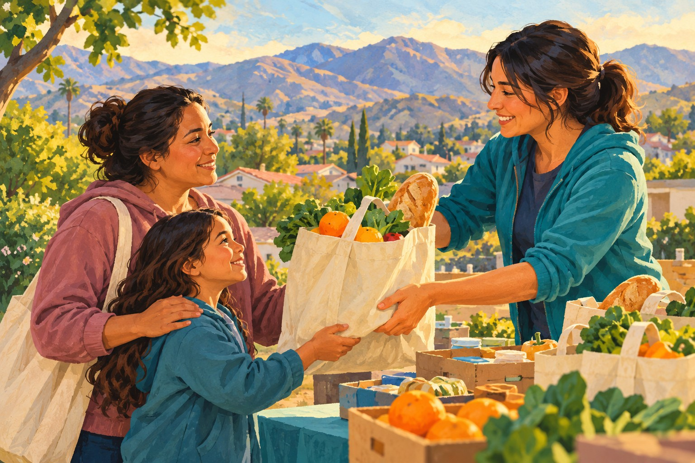
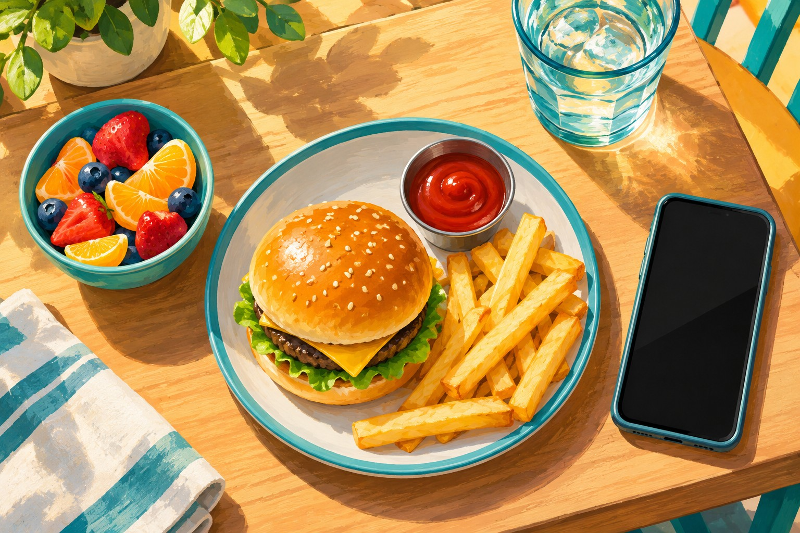
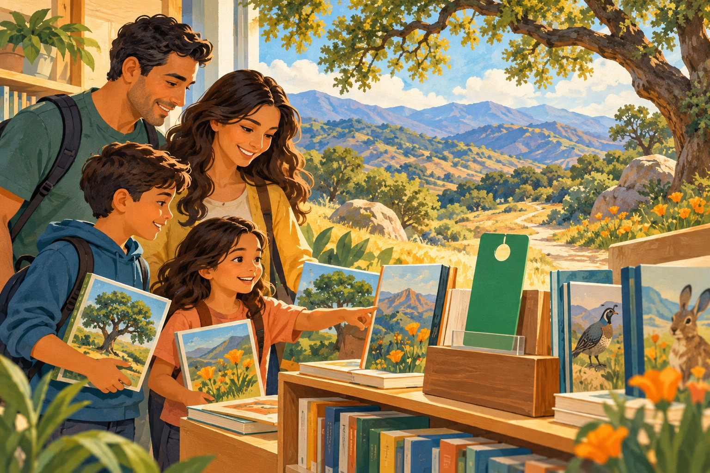
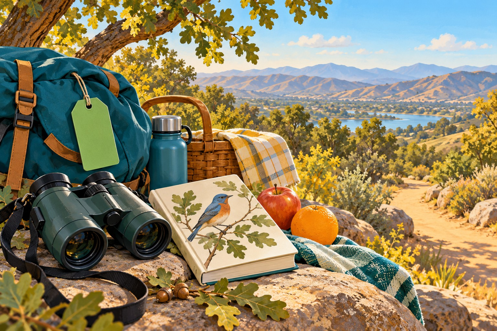
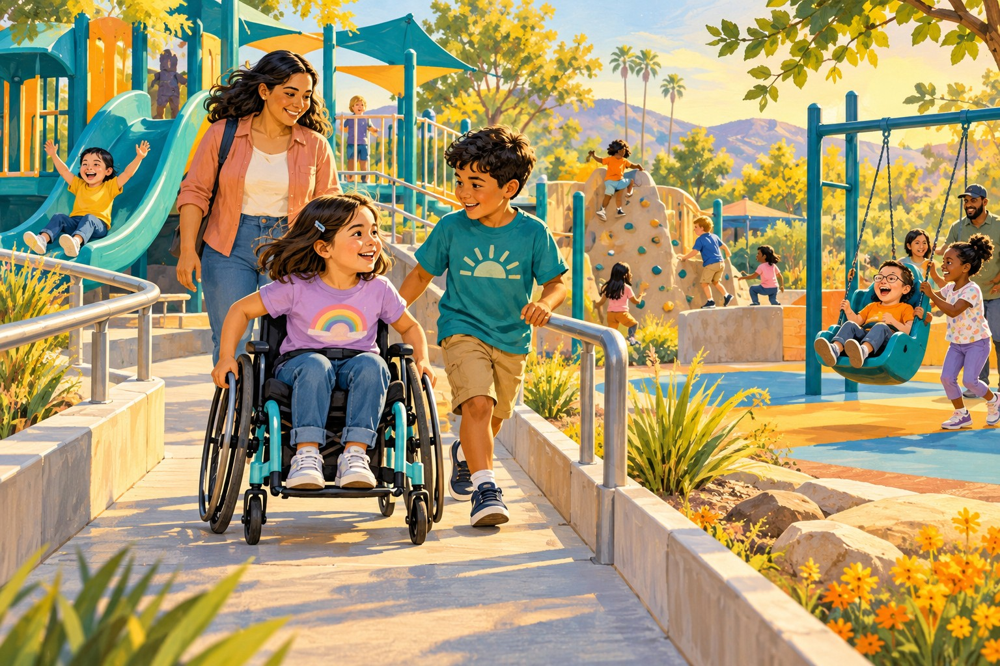
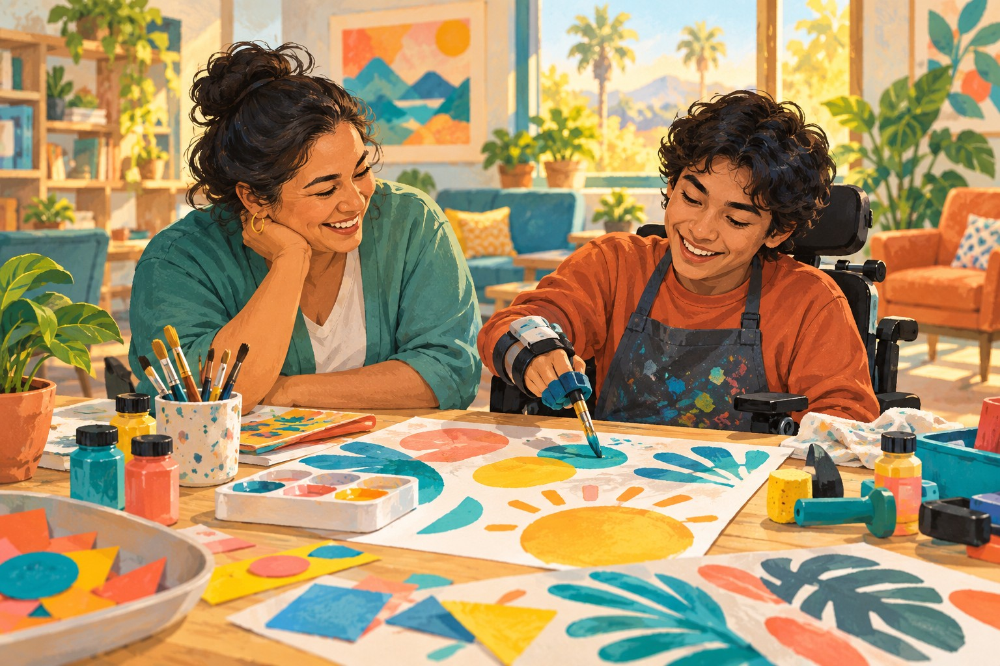
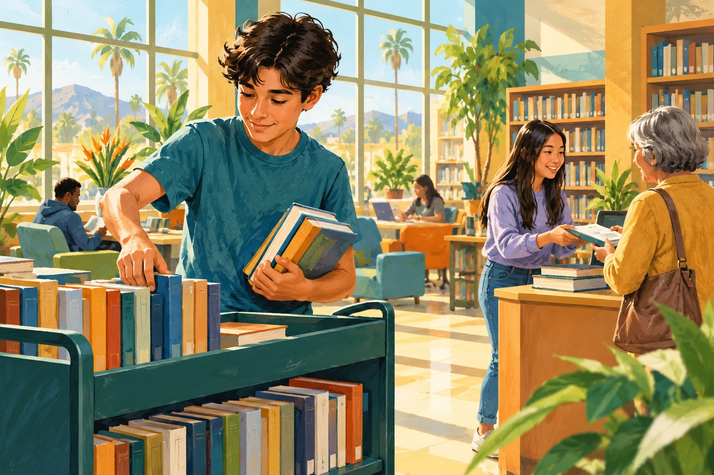
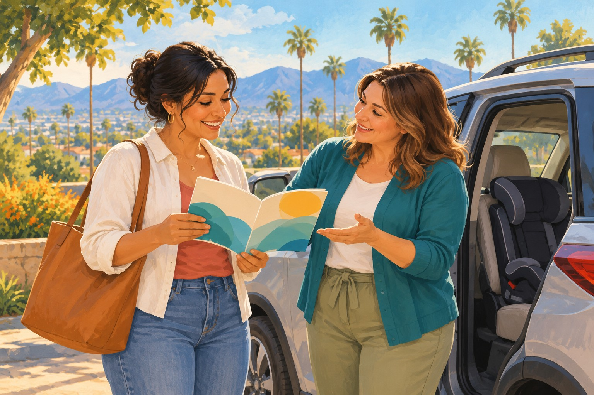
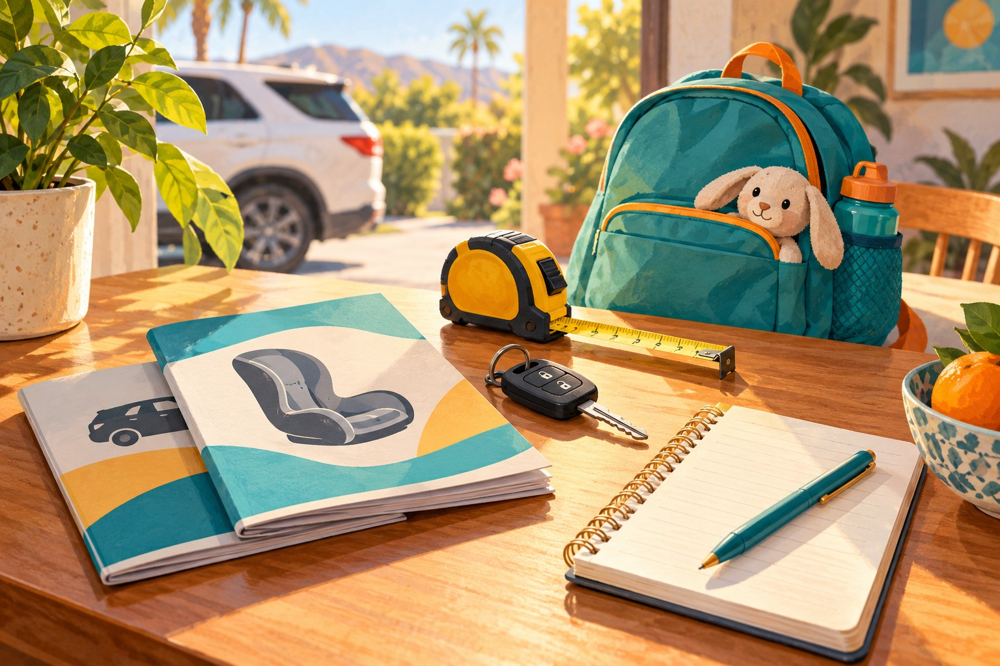
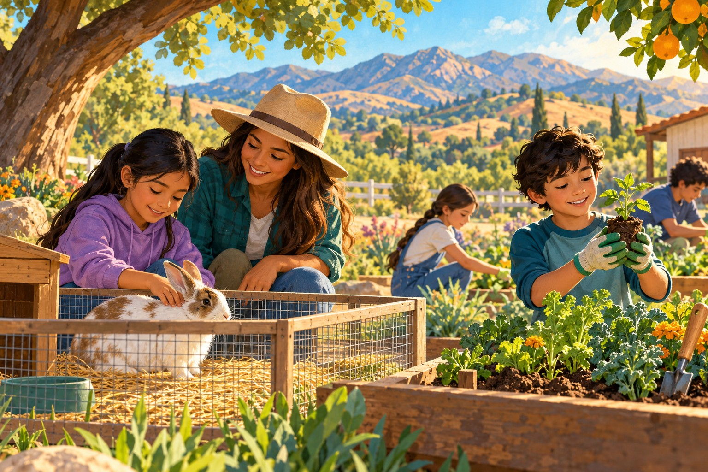

# Family resource article illustrations

Twenty AI-generated editorial illustrations made with the built-in image_gen tool. These are conceptual scenes, not photographs of actual local people, places or programs. [Generation prompts](prompts.json).

## corona-family-assistance

Featured:

Supporting:

## corona-swim-lessons

Featured:

Supporting:

## corona-kids-eat-free

Featured:

Supporting:

## corona-library-free-passes

Featured:

Supporting:

## corona-special-needs-support

Featured:

Supporting:

## corona-teen-jobs-volunteering

Featured:

Supporting:

## corona-scholarships-fafsa

Featured:

Supporting:

## corona-car-seat-safety

Featured:

Supporting:

## corona-norco-4h

Featured:

Supporting:

## corona-family-emergency-plan

Featured:

Supporting:

